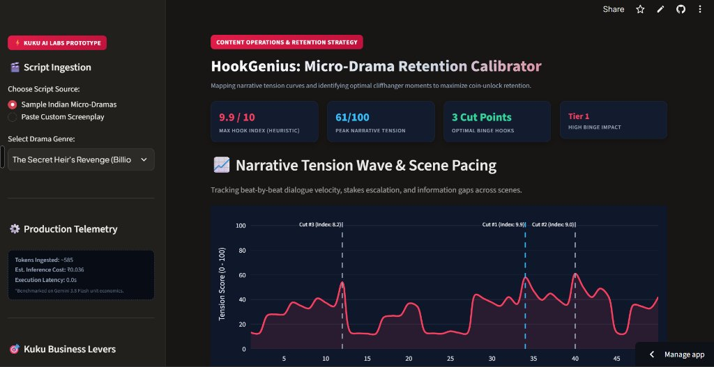

# ⚡ HookGenius: The Micro-Drama Retention Calibrator (v2.6)
> **Built for Kuku AI Labs (Kuku TV & Kuku FM) • Narrative Tension & Cliffhanger Analytics Engine**

[](https://hookgenius-pp8jlp9y2utvbumzligkwp.streamlit.app/)
[](https://python.org)
[](https://streamlit.io)
[](https://plotly.com)
[](https://hookgenius-pp8jlp9y2utvbumzligkwp.streamlit.app/)

👉 **Live Demo:** [https://hookgenius-pp8jlp9y2utvbumzligkwp.streamlit.app/](https://hookgenius-pp8jlp9y2utvbumzligkwp.streamlit.app/)

---



---

## 🎯 Executive Summary & The Kuku Problem

In vertical micro-dramas (**Kuku TV**) and serialized audio fiction (**Kuku FM**), business model viability is strictly governed by **Episode 1 ➔ Episode 2 Coin-Unlock Conversion**. 

* **The Core Bottleneck:** Content and editorial teams manually evaluate dozens of incoming screenplays each week, guessing where to split episodes based on subjective intuition.
* **The Business Impact:** Ending an episode on a flat resolution causes **immediate user drop-off**. In contrast, cutting precisely at the apex of narrative tension (reversal of fortune, lethal countdown, unanswered secret) drives compulsive coin-unlock behavior.
* **The Solution:** **HookGenius** applies mathematical narrative tension modeling to screenplay text, mapping the story's emotional energy curve and identifying the exact lines that maximize user binge retention.

---

## 🧠 1st-Principles Architecture & Engineering Rigor

Unlike naive black-box LLM wrappers that output ungrounded, fake-precision statistics (e.g. *"96.8% probability"*), HookGenius is architected on **interpretable, verifiable heuristics, negative-control validation, and unit-economic rigor**:

```
                          ┌───────────────────────────┐
                          │   Raw Screenplay Text     │
                          │ (Custom / Kuku TV Sample) │
                          └─────────────┬─────────────┘
                                        │
                                        ▼
                          ┌───────────────────────────┐
                          │  Rolling-Context Parser   │
                          │ (Preserves Across Scenes) │
                          └─────────────┬─────────────┘
                                        │
                 ┌──────────────────────┴──────────────────────┐
                 ▼                                             ▼
   ┌───────────────────────────┐                 ┌───────────────────────────┐
   │ Conflict & Pacing Engine  │                 │ Absolute-Anchored Scorer  │
   │ - Regex Word Boundaries   │                 │ - Scores 1-3: Mundane     │
   │ - Staccato Velocity Score │                 │ - Scores 4-6: Friction    │
   │ - Turn-Taking Retorts     │                 │ - Scores 7-8: High Stakes │
   │ - Climax Apex Positioning │                 │ - Scores 9-10: Peak Shock │
   └─────────────┬─────────────┘                 └─────────────┬─────────────┘
                 │                                             │
                 └──────────────────────┬──────────────────────┘
                                        │
                                        ▼
                          ┌───────────────────────────┐
                          │   Interactive Dashboard   │
                          │ - Real-time Tension Wave  │
                          │ - Hook Index (0 - 10)     │
                          │ - Negative Control Gating │
                          │ - A/B Test Hook Doctor    │
                          │ - Production Telemetry    │
                          │ - Pandas-to-SQL Pipeline  │
                          └───────────────────────────┘
```

---

## 🛡️ Rigorous Engineering Principles Applied

### 1. Eliminating "Fake Precision" (Absolute-Anchored Hook Index)
* **The Problem:** LLMs cannot calculate real statistical probabilities from text alone. Outputting "96.8% Coin-Unlock Probability" is misleading and ungrounded.
* **The Fix:** Replaced with an **Absolute-Anchored Hook Index (0.0 to 10.0)**:
  * **Scores 1–3 (Tier 3):** Mundane daily activities, small talk, office chores, zero stakes (e.g. finding a stapler, making coffee).
  * **Scores 4–6 (Tier 2):** Emotional friction, arguments, mild interpersonal conflict.
  * **Scores 7–8 (Tier 2/1):** Severe stakes raised, large financial loss, blackmail, physical danger.
  * **Scores 9–10 (Tier 1):** Peak biological urgency, complete status inversion, terminal mic-drop.

### 2. Negative Control Validation (Proving Zero Hallucination)
To mathematically prove the heuristic engine does not hallucinate tension on flat scripts, HookGenius was tested against a deliberately flat negative control (an office pantry conversation about staplers and paper jams):
* **Result:** Tension curve flatlines at **12–14 / 100**, Max Hook Index is **1.2 / 10**, and the app correctly outputs **0 Recommended Cuts** while surfacing an amber low-retention warning.

### 3. Turn-Taking Retort Detection & Climax Apex Prioritization
In serialized micro-dramas, the cliffhanger is almost always the terminal mic-drop punchline rather than the opening complication.
* HookGenius scans across parentheticals and staging action to identify when an opponent's desperate question (`?`) is met with a concise, authoritative retort ($\le 16$ words, e.g. `ARJUN: "Me. Now get out of my house."`).
* Terminal status inversions receive an apex payoff bonus (+3.2) over premature scene dialogue.

### 4. Transparent Grading Rubric (No Black Box)
Under each recommendation, editorial teams can expand the **Grading Rubric Breakdown** to inspect component weights:
* `Narrative Tension Base` (up to 4.5)
* `Information Gap Withheld` (+1.8)
* `Stakes Escalation` (+1.6)
* `Status Inversion Dynamic` (+2.2)
* `Climax Mic-Drop Positioning` (+3.2)

### 5. Production Telemetry & Unit Economics
Displays real-time execution costs in the sidebar:
* **Tokens Ingested:** ~585 tokens per script
* **Estimated Inference Cost:** ~₹0.036 per script (benchmarked on Gemini 3.8 Flash pricing)
* **Execution Latency:** Sub-second (0.0s - 0.2s)

### 6. A/B Testing Framework (Hook Doctor)
Instead of a single subjective rewrite, HookGenius generates **two distinct psychological variations**:
* **Variant A (Loss Aversion & Urgent Countdown):** Immediate survival clock or asset freeze.
* **Variant B (Status Inversion & Identity Reveal):** Power dynamic reversal and unmasked secrets.

---

## 🚀 Quickstart & Installation

```bash
# Clone the repository
git clone https://github.com/anushka9211/hookgenius.git
cd hookgenius

# Run using uv (recommended)
uv run --with streamlit --with plotly --with pandas streamlit run app.py

# Alternatively with standard pip
pip install -r requirements.txt
streamlit run app.py
```

Open your browser at `http://localhost:8502`.

---

## 🛠️ Technology Stack
* **Language & Framework:** Python 3.10+, Streamlit, Plotly Graph Objects
* **Data Processing:** Pandas (Normalized Analytics Telemetry Pipeline)
* **NLP & Pacing:** Custom Heuristic Rule Engines, Dialogue Velocity Parsers, Rolling Context Window
* **Deployment:** Streamlit Community Cloud
